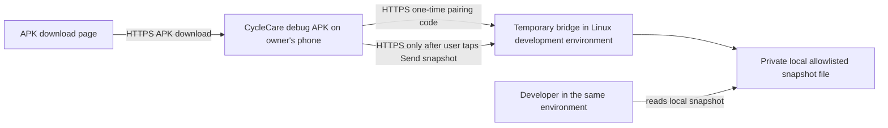

# CycleCare Remote Debug: Architecture and Limits

## What this build does

This is a **debug-only CycleCare APK** with a small opt-in support panel. It helps the owner and developer confirm that the app is running on a real Android device, inspect a deliberately limited device/build/connectivity snapshot, and deliver that snapshot to the current development environment.

It is not a generic remote-control agent. It does not capture the screen, read Android logcat, access the CycleCare database, collect symptoms or notes, or accept remote taps/commands.

## Components

- **Android app:** The regular CycleCare debug build, shown as **CycleCare Debug**, with an internal `RemoteDebugActivity` linked from Settings only when `BuildConfig.DEBUG` is true. Debug builds use a `.debug` application ID suffix so they install beside, not over, a production CycleCare app and use separate app storage.
- **Bridge:** `debug-bridge/bridge_server.py`, a short-lived Python standard-library HTTP service bound to port 8765. The environment's public service URL terminates HTTPS and forwards to that port. The bridge itself does not persist requester IPs in its access log.
- **Pairing:** On bridge startup, it creates a random 10-character one-time code that expires after 24 hours. The owner enters the code and approves the temporary session in the app. The bridge returns a random bearer token; the app keeps it in memory only. Pairing requests are rate-limited, the code is consumed once, and disconnect invalidates the session.
- **Snapshot:** The app sends no report automatically. The owner must tap **Send diagnostic snapshot**. The bridge accepts an exact field allowlist and writes only the latest snapshot to a local directory with owner-only permissions; it does not expose a public report-reading endpoint or retain requester IP access logs.

## Exact data boundary

The snapshot contains only:

- CycleCare app version string
- Android release string and API level
- Whether Android currently reports an internet-capable active network
- UTC report timestamp

It excludes cycle dates, symptoms, free-text notes, account identifiers/email, authentication tokens, device serial/advertising IDs, app database contents, screen contents, contacts, and payment information. The app pairs using the code only; it sends the snapshot separately, only after the owner presses the send button.

## Install and test

1. Open the APK download page supplied with the task on the Android phone and download the debug APK.
2. If Android prompts, permit the browser/file manager to install this one APK. The build is debug-signed and not a Play Store release.
3. Open the separate **CycleCare Debug** app, complete its initial setup with a test account, and go to **Settings → Remote debug (test build)**.
4. Enter the one-time pairing code supplied in chat and approve the session. Tap **Send diagnostic snapshot** only when you choose to share it.
5. The developer can inspect the saved snapshot locally at `/tmp/cyclecare-debug-bridge/last_report.json` while the bridge is running. End the session from the app when done.

Use a test account and test data. The debug APK connects to the app's configured services just like the app build; the debug suffix isolates local app storage, but it does not create a separate backend.

## Security and operational limits

- The bridge is temporary and should be stopped when the debug session is complete. Its pairing code is one-time and short-lived; the session token exists only in the app's memory and in the running bridge process.
- HTTPS is required by the app. There is no plaintext HTTP fallback. The server accepts only the listed fields and rejects extra/free-text fields.
- This is snapshot-based troubleshooting, not live telemetry. It cannot show a screen, extract logcat, inspect local health records, tap the app, or reinstall/upgrade the app remotely.
- A physical Android phone is needed for real device validation; the current Linux environment has no `/dev/kvm`, so the Android emulator is not a reliable validation path here.

## If interactive remote debugging is needed later

Use a dedicated opt-in foreground session, separate from this MVP:

1. The owner starts screen sharing and approves Android's `MediaProjection` system prompt. A persistent Android foreground-service notification must remain visible with an obvious stop action.
2. The phone initiates an outbound TLS WebSocket to a short-lived relay; do not open an inbound phone port or embed a long-lived server credential in the APK.
3. Keep screen video off by default and do not persist recordings. Health screens should be hidden/redacted; require an explicit per-session consent screen before any video leaves the device.
4. Do not implement remote taps by default. Android accessibility control is a distinct, powerful permission the owner must enable in system Settings; if a future workflow truly needs it, scope actions narrowly, display each action, and provide immediate revoke/stop controls.
5. Prefer Android Studio/ADB over USB or Android Wireless Debugging on a trusted local network for developer-level logs and instrumentation. A cloud sandbox cannot ordinarily reach a phone's private LAN address, so a relay is needed for off-network sessions.

Before enabling any future live control, separately assess security, store-policy/privacy disclosure, health-data minimization, authentication, session expiry, auditability, and the intended test-account/backend environment.
